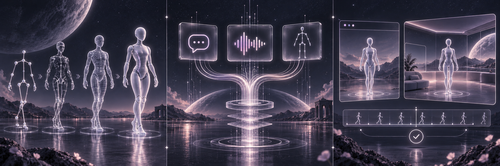
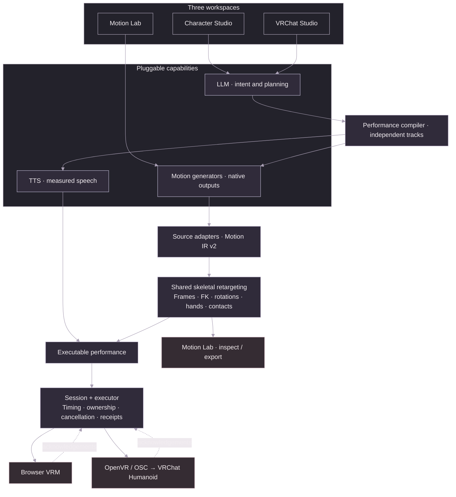

<p align="center">
  
</p>
<h1 align="center">VIREA</h1>
<p align="center"><sub>Verifiable Interaction Runtime for Embodied Agents</sub></p>

<p align="center">
  <a href="README.md"></a>
  <a href="README.zh-CN.md"></a><br>
  <a href="doc/README.en.md"></a>
  <a href="doc/getting-started/automatic-setup.en.md"></a>
  <a href="doc/demos/README.en.md"></a>
</p>

<a id="from-motion-generation-to-embodied-conversation"></a>
<a id="choose-your-path"></a>
<a id="model-support"></a>
<a id="documentation"></a>
## ✦ From an idea to a moving character

**VIREA connects language, speech and motion models to characters that you can watch and interact with.** It retargets native skeletal output onto VRM avatars in the browser and Humanoid avatars in VRChat, with a complete path from model setup to generation, playback and inspection.



<table>
<tr>
<td width="33%" valign="top"><h3>01 · 🦴 Motion that fits your rig</h3><p>Source rest frames, joint hierarchies and rotation conventions enter one retargeting foundation. Inspect the original skeleton beside your avatar, including hands, root movement and ground contact.</p><a href="doc/math-retarget/README.zh-CN.md">Explore the mathematics →</a></td>
<td width="33%" valign="top"><h3>02 · 🔌 Models you can combine</h3><p>Use MotionCraft, SynTalker, ARDY and other catalog models through adapters for their native output. Connect cloud or local LLMs and TTS through typed capability ports and verify each with a real generation.</p><a href="doc/models/README.en.md">Meet the models →</a></td>
<td width="33%" valign="top"><h3>03 · 🎬 One complete performance</h3><p>Speech and movement have independent timelines. Prepare an action sequence, place speech where it belongs, and deliver it to the browser or VRChat. Versioned messages, artifacts and execution receipts make each step inspectable.</p><a href="doc/architecture/contracts.en.md">Read the contracts →</a></td>
</tr>
</table>

---

## 🧭 Where VIREA fits

Different projects start from companionship, animation authoring or motion capture. VIREA brings generation, retargeting and embodied execution into a shared runtime.

| Project | LLM + speech | Generated motion | Native skeleton → VRM | Browser avatar | VRChat execution | Independent tracks | Motion / execution contracts |
|:--|:--:|:--:|:--:|:--:|:--:|:--:|:--:|
| [Project Gabriel](https://github.com/HoppouAI/ProjectGabriel-Remastered/tree/motion-server) | ✅ | ✅ | ❌ | ❌ | ✅ | ❌ | ❌ |
| [rexclaw](https://github.com/Codemarchant/rexclaw) | ✅ | ✅¹ | ❌ | ✅ | ❌ | ❌ | ❌ |
| [text-to-vrma](https://github.com/Kirakun0328/text-to-vrma) | ❌ | ✅ | ✅ | ✅ | ❌ | ❌ | ❌ |
| [MotionMind](https://github.com/rohitacharyams/MotionMind) | ✅ | ❌² | ✅ | ✅ | ❌ | ❌ | ❌ |
| [ChatVRM](https://github.com/pixiv/ChatVRM) | ✅ | ❌ | ❌ | ✅ | ❌ | ❌ | ❌ |
| **VIREA** | ✅ | ✅ | ✅ | ✅ | ✅ | ✅ | ✅ |

<sub>✅ Implemented in the reviewed scope · ❌ Not provided in that scope. ¹ Through Text-To-VRMA integration. ² MotionMind reconstructs motion from video and composes clips. Independent tracks means explicitly scheduled speech and motion; contracts means both normalized motion and target execution receipts. Reviewed October 11, 2026. [Definitions, revisions and sources](doc/comparison.en.md).</sub>

---

<a id="start-without-a-development-environment"></a>
<a id="quick-start"></a>
## 🚀 Set up

**Start with a folder and the launcher.** [Download the source ZIP](https://github.com/Moonweave-AI/virea/archive/refs/heads/main.zip) and extract it, or clone with Git:

```sh
git clone https://github.com/Moonweave-AI/virea.git
cd virea
```

Run the command for your system from the project folder:

| Windows · PowerShell | macOS / Linux · Terminal |
|:--|:--|
| `.\Start-VIREA.cmd` | `sh start-virea.sh` |

The launcher prepares Python, Node.js and application dependencies, builds the interface and starts VIREA. The same command starts it again next time.

1. Open **[Set Up](http://127.0.0.1:8000/app/setup.html)** when the launcher is ready.
2. Choose your **language, speech and motion** providers. Detect available models and voices, or deploy a local model from the catalog.
3. Run **generation verification**, then enter **Motion Lab**, **Character Studio** or **VRChat Studio**.

> [!TIP]
> Browser workspaces run on Windows, Linux and macOS. VRChat integration runs on Windows. Local model requirements are shown before installation; start with the capabilities you need.

[Full setup guide](doc/getting-started/automatic-setup.en.md) · [Platform guide](doc/platforms/README.en.md) · [Troubleshooting](doc/operations/troubleshooting.en.md)

---

<a id="demos"></a>
<a id="vrchat-execution-bridge"></a>
<a id="single-family-routes-16-complex-task-demos"></a>
<a id="motion-studio-demos"></a>
## 🎞️ Demos

### VRChat Studio

Conversation and generated movement · 1 min 53 sec

https://github.com/user-attachments/assets/c31d1bfe-b35e-4ceb-a77d-034043bf54fe

### Character Studio

One character, three motion routes.

<table>
<tr><th width="33%">MotionCraft</th><th width="33%">SynTalker</th><th width="33%">ARDY + SentiAvatar</th></tr>
<tr>
<td align="center"><video src="https://github.com/user-attachments/assets/5a641799-897b-4f66-934e-22227d4a27b3" controls muted preload="metadata" width="250" height="220"></video></td>
<td align="center"><video src="https://github.com/user-attachments/assets/8712149b-cb6b-4111-b085-856d914d6d2a" controls muted preload="metadata" width="250" height="220"></video></td>
<td align="center"><video src="https://github.com/user-attachments/assets/ead22345-362c-493a-8fa5-6e0c9e085447" controls muted preload="metadata" width="250" height="220"></video></td>
</tr>
<tr><td align="center">32 s · Text + speech</td><td align="center">32 s · Text + speech</td><td align="center">40 s · Dialogue + behavior</td></tr>
</table>

### Motion Lab

Native skeleton and retargeted VRM, side by side · 14 sec

https://github.com/user-attachments/assets/9dc77be4-7195-4c96-840f-e61f05276103

[All demos and reproduction notes](doc/demos/README.en.md) · [Video files and provenance](doc/assets/featured-demos/README.md)

<sub>Character Studio demo avatar: Unnamed Character 6 by Reira. <a href="THIRD_PARTY_NOTICES.md">Credits & terms</a>.</sub>

---

<a id="architecture"></a>
<a id="motion-infrastructure"></a>
<a id="runtime-and-retargeting-foundation"></a>
<a id="execution-domain-selection-and-evidence"></a>
<a id="resource-admission-and-fallback"></a>
<a id="motion-and-result-contracts"></a>
<a id="repository-structure"></a>
<a id="validation"></a>
## 🧩 Architecture

**One capability system. One motion foundation. Multiple execution targets.** The workspaces share model interfaces and skeletal mathematics. Each target handles its own rendering or device transport.



| Layer | Responsibility | Code |
|:--|:--|:--|
| Capabilities | Interchangeable language, audio, motion, source and embodiment interfaces | [`src/virea/ports/`](src/virea/ports/) |
| Contracts & orchestration | Plans, measured timing, immutable artifacts, body ownership and receipts | [`packages/contracts/`](packages/contracts/) · [`src/virea/application/`](src/virea/application/) |
| Motion foundation | Native source adapters, rest frames, FK and skeletal retargeting | [`src/virea/motion/`](src/virea/motion/) · [`packages/retarget/`](packages/retarget/) |
| Execution & operations | Browser playback, VRChat tracking, model workers and deployment | [`apps/`](apps/) · [`src/virea/vrchat/`](src/virea/vrchat/) · [`plugins/models/`](plugins/models/) |

[Architecture guide](doc/architecture/overview.en.md) · [Timing and execution](doc/architecture/execution.en.md) · [Model integration](doc/development/model-adapter.zh-CN.md)

---

<a id="contributing-security-and-distribution"></a>
## 🤝 Contributing

Bring a model adapter, a clearer guide, a reproducible motion example or a fix. Start with the [contribution guide](CONTRIBUTING.md), choose a focused change, and include the checks that show it works. For motion changes, an original-skeleton / target-avatar comparison is especially useful.

---

## 🛡️ Security & responsible use

Use avatars and voice references you have permission to use. Keep provider keys and private conversations local, and operate VRChat accounts with the consent of the people involved. See the [security policy](SECURITY.md) for private reporting and the [asset credits](THIRD_PARTY_NOTICES.md) for model, dataset and avatar terms.

---

## 📄 License

The VIREA code license is awaiting the maintainers' selection. Third-party models, datasets and avatars retain their own licenses, listed in [Third-party notices](THIRD_PARTY_NOTICES.md).

<!--
type: readme
status: Active
owner: VIREA maintainers
created: 2026-10-11
updated: 2026-10-11
last_reviewed: 2026-10-11
review_cycle_days: 30
summary: Project overview, verified comparison, quick setup, five selected videos and shared architecture.
canonical: README.md
related: []
supersedes: []
superseded_by: []
-->
