# VIREA

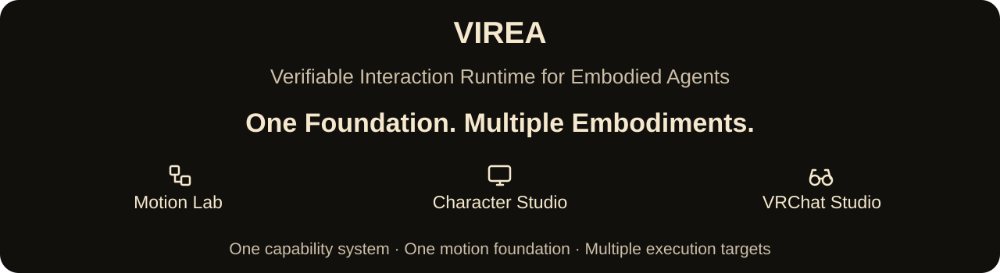

[English](README.md) · [简体中文](README.zh-CN.md) · [Documentation](doc/README.en.md) · [Set up](doc/getting-started/automatic-setup.en.md) · [Demos](#demos)

**VIREA connects language, speech and motion models to interactive characters.** Generate motion on its own, talk to a character in the browser, or operate an independent AI character in VRChat. All three workflows share model connections, skeleton conversion and execution records.

## Choose your workspace

| Workspace | What you can do | Start here |
|---|---|---|
| **Motion Lab** | Generate motion, compare source and target skeletons, and export animation | [Motion generation](doc/workflows/motion-lab.en.md) |
| **Character Studio** | Import a VRM, hold a conversation, and arrange independent speech and motion tracks | [Character interaction](doc/workflows/character-studio.en.md) |
| **VRChat Studio** | Control a separate AI account and watch its motion and subtitles from an observer account | [VRChat operation](doc/workflows/vrchat-studio.en.md) |

## Start from zero

1. [Download the source ZIP](https://github.com/Moonweave-AI/virea/archive/refs/heads/main.zip) and extract it. On Windows, double-click **Start-VIREA.cmd**. On macOS, open **Start-VIREA.command**. On Linux, run **sh start-virea.sh** in the project folder.
2. Let the launcher prepare Python, Node and dependencies. It opens the setup wizard and shows deployment progress and the current step.
3. Choose a cloud provider or a detected local model. Enter a provider key, then select a model and voice from the discovered lists. For local models, click **Detect and deploy**.
4. Run **Generate and verify**. Inspect the actual text, audio waveform or motion frames and download the result before activating the connection.
5. Open your workspace. Motion Lab needs a motion model; the two interactive workspaces add language and speech as needed.

| Environment | Workflows |
|---|---|
| Windows | All three workspaces, including dual VRChat clients and the virtual VR driver |
| Linux, macOS | Motion Lab, Character Studio, model connections and deployment |
| Windows + WSL2 | Windows hosts the browser and VRChat; models can run in a selected WSL2 environment |

Language providers include OpenAI, DeepSeek, Anthropic, Alibaba Bailian, Gemini, OpenRouter and compatible services. Speech providers include OpenAI Speech, Bailian, ElevenLabs, Azure and local services. Setup detects hardware and offers suitable runtimes. See the [model catalog](doc/models/README.en.md) for resource requirements.

The first launch opens `http://127.0.0.1:8000/app/setup.html`. Configuration, models and results live under the project's `.virea-runtime/` folder. Later launches reuse the environment. Speech verification generates a file; playback is controlled by the user.

[Installation walkthrough](doc/getting-started/automatic-setup.en.md) · [Choose a data disk](doc/getting-started/persistent-data-root.en.md) · [Troubleshooting](doc/operations/troubleshooting.en.md)

## One shared foundation

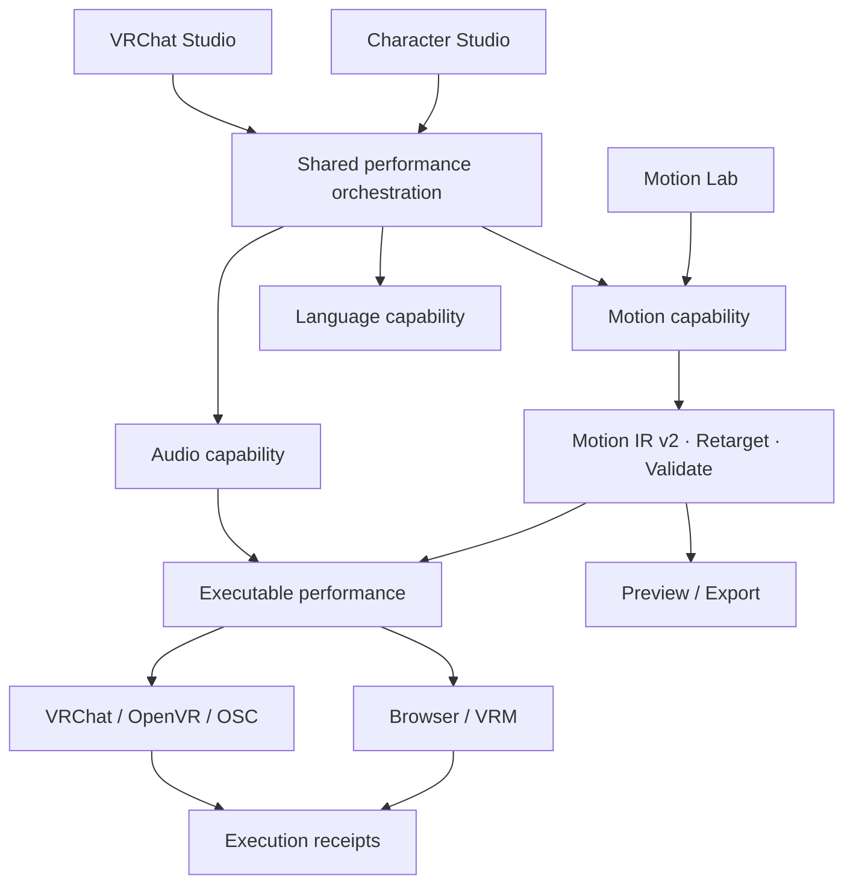

Speech and motion share a timeline while keeping their own lengths and start times. Short English captions describe motion stages; speech can begin anywhere and cross action boundaries. Measured audio samples determine speech duration. Each motion model retains its native history and inference procedure.

Execution records distinguish planning, generation, validation, transmission, device acknowledgement and visual observation. A new turn cancels old work and advances the session epoch. Both execution targets consume the same validated performance data.

[Architecture](doc/architecture/overview.en.md) · [Contracts](doc/architecture/contracts.en.md) · [Timing and execution](doc/architecture/execution.en.md)

The shared motion foundation manages hierarchy, bone lengths, local axes and rotation propagation. Hands are evaluated from per-frame model parameters. Native output, retargeted motion and playback curves are recorded separately so the same sample can be compared across characters. [Skeletal mathematics and measurements](doc/research/skeletal-retargeting-2026-10-11.md) · [VRChat motion execution](doc/quality/vrchat-motion.md).

## See it in action

These existing recordings show four continuous VRChat interactions and eight browser performances each for MotionCraft and SynTalker. [Recording conditions and review records](doc/quality/vrchat-recordings.md) include file hashes and check results.

<!-- BEGIN VRCHAT_DEMOS -->
### Four continuous VRChat interactions

**1. Exhibition tour — MotionCraft · 5:17.6.** Introduce a fictional exhibit, explain reflected light, adapt to a child visitor, then answer and recap.

https://github.com/user-attachments/assets/df0ff097-dec3-4400-afe8-5341554778f6

**2. Rhythm coaching — SynTalker · 5:39.6.** Establish a turn-taking rule, wait for readiness, correct the learner and recap the practice.

https://github.com/user-attachments/assets/e8725f1d-dc6b-4e38-bb59-ad93d6596656

**3. Lighthouse story — MotionCraft → SynTalker · 5:16.5.** Choose a route, retain the blue-map/no-swimming constraints, adapt to rain and recall the story after switching methods.

https://github.com/user-attachments/assets/be775ee7-0f9e-42c3-8a15-da52c81487af

**4. Presentation rehearsal — SynTalker → MotionCraft · 5:47.4.** Introduce a book exchange, clarify that it is free, switch to a shortened closing and summarize the corrections.

https://github.com/user-attachments/assets/34f49bd8-a4d7-4852-be7c-875032a364b5
<!-- END VRCHAT_DEMOS -->

<!-- BEGIN UNIFIED_MOTION_DEMOS -->

### MotionCraft

<table>
<tr>
<td width="50%" valign="top"><strong>Welcome and introduction</strong>  32s · 6 actions · 2 speech clips · motioncraft + Audio8-TTS</td>
<td width="50%" valign="top"><strong>Warm-up coach</strong> <a href="doc/assets/unified-motion-demos/motioncraft-02-warmup.mp4">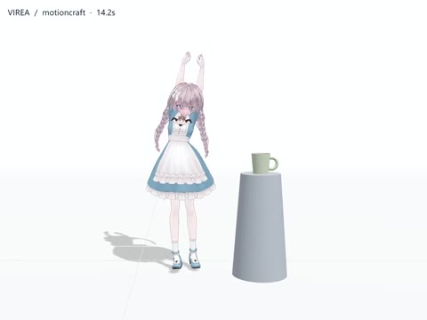</a> 36s · 6 actions · 2 speech clips · motioncraft + Audio8-TTS</td>
</tr>
<tr>
<td width="50%" valign="top"><strong>Garden story</strong> <a href="doc/assets/unified-motion-demos/motioncraft-03-story.mp4">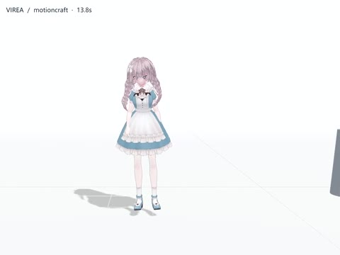</a> 35s · 6 actions · 2 speech clips · motioncraft + Audio8-TTS</td>
<td width="50%" valign="top"><strong>Dance lesson</strong> <a href="doc/assets/unified-motion-demos/motioncraft-04-dance.mp4">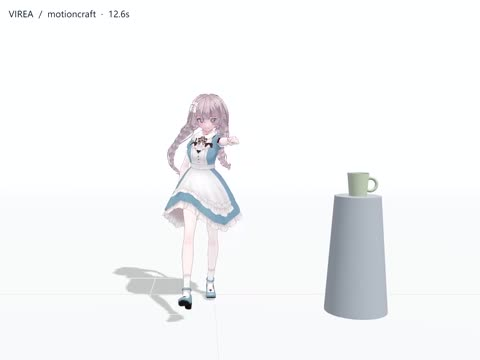</a> 32s · 6 actions · 2 speech clips · motioncraft + Audio8-TTS</td>
</tr>
<tr>
<td width="50%" valign="top"><strong>Fashion presentation</strong> <a href="doc/assets/unified-motion-demos/motioncraft-05-fashion.mp4">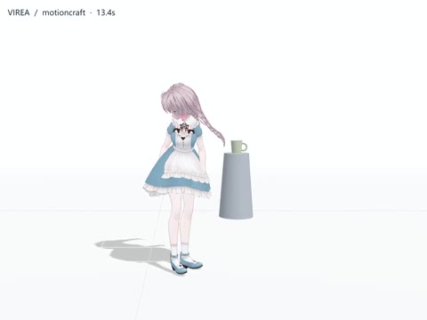</a> 34s · 7 actions · 2 speech clips · motioncraft + Audio8-TTS</td>
<td width="50%" valign="top"><strong>From tension to celebration</strong> <a href="doc/assets/unified-motion-demos/motioncraft-06-emotion.mp4">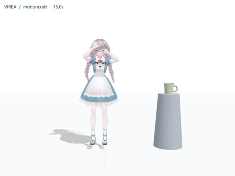</a> 33s · 6 actions · 2 speech clips · motioncraft + Audio8-TTS</td>
</tr>
<tr>
<td width="50%" valign="top"><strong>Walking guide</strong> <a href="doc/assets/unified-motion-demos/motioncraft-07-tour.mp4">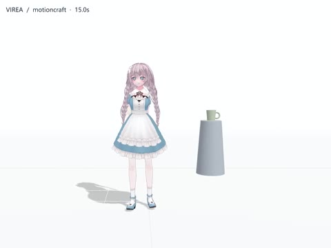</a> 38s · 6 actions · 2 speech clips · motioncraft + Audio8-TTS</td>
<td width="50%" valign="top"><strong>Boxing practice</strong> <a href="doc/assets/unified-motion-demos/motioncraft-08-boxing.mp4">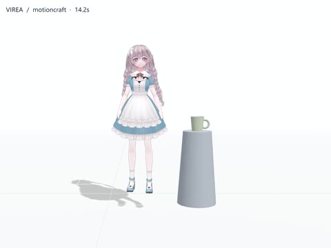</a> 36s · 7 actions · 2 speech clips · motioncraft + Audio8-TTS</td>
</tr>
</table>

### SynTalker

<table>
<tr>
<td width="50%" valign="top"><strong>Welcome and introduction</strong> <a href="doc/assets/unified-motion-demos/syntalker-01-introduction.mp4">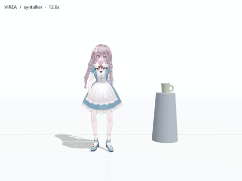</a> 32s · 6 actions · 2 speech clips · syntalker + Audio8-TTS</td>
<td width="50%" valign="top"><strong>Warm-up coach</strong> <a href="doc/assets/unified-motion-demos/syntalker-02-warmup.mp4">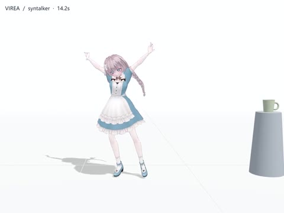</a> 36s · 6 actions · 2 speech clips · syntalker + Audio8-TTS</td>
</tr>
<tr>
<td width="50%" valign="top"><strong>Garden story</strong> <a href="doc/assets/unified-motion-demos/syntalker-03-story.mp4">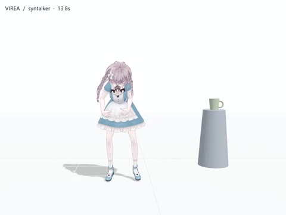</a> 35s · 6 actions · 2 speech clips · syntalker + Audio8-TTS</td>
<td width="50%" valign="top"><strong>Dance lesson</strong> <a href="doc/assets/unified-motion-demos/syntalker-04-dance.mp4">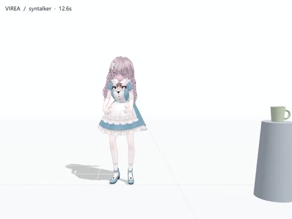</a> 32s · 6 actions · 2 speech clips · syntalker + Audio8-TTS</td>
</tr>
<tr>
<td width="50%" valign="top"><strong>Fashion presentation</strong> <a href="doc/assets/unified-motion-demos/syntalker-05-fashion.mp4">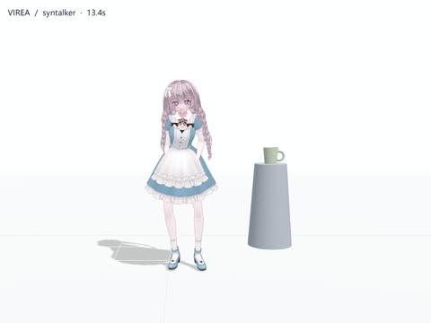</a> 34s · 7 actions · 2 speech clips · syntalker + Audio8-TTS</td>
<td width="50%" valign="top"><strong>From tension to celebration</strong> <a href="doc/assets/unified-motion-demos/syntalker-06-emotion.mp4">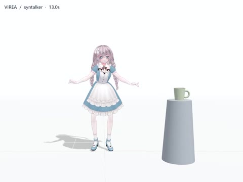</a> 33s · 6 actions · 2 speech clips · syntalker + Audio8-TTS</td>
</tr>
<tr>
<td width="50%" valign="top"><strong>Walking guide</strong> <a href="doc/assets/unified-motion-demos/syntalker-07-tour.mp4">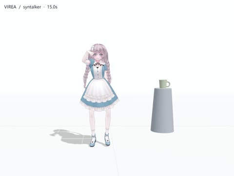</a> 38s · 6 actions · 2 speech clips · syntalker + Audio8-TTS</td>
<td width="50%" valign="top"><strong>Boxing practice</strong> <a href="doc/assets/unified-motion-demos/syntalker-08-boxing.mp4">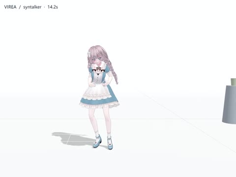</a> 36s · 7 actions · 2 speech clips · syntalker + Audio8-TTS</td>
</tr>
</table>
<!-- END UNIFIED_MOTION_DEMOS -->

[MotionCraft / SynTalker — 技术梗概 / Technical notes](doc/character/unified-motion.en.md) · [Gallery](doc/assets/unified-motion-demos/index.html)

SentiAvatar + ARDY

<!-- BEGIN CHARACTER_DEMOS -->
**8 complete performances in a two-column gallery.** Each recording follows a model-generated plan. Open the task notes for timing measurements.

<table>
<tr>
<td width="50%" valign="top"><strong>01 · Stage host</strong> Opening speech → walking, turning and greeting → invite the audience. <video src="https://github.com/user-attachments/assets/7c4006eb-5662-4c46-8697-df720d7d2e9b" controls width="100%"></video> Full performance · 39.2s SentiAvatar ↔ ARDY · Kokoro</td>
<td width="50%" valign="top"><strong>02 · Warm-up coach</strong> Explain the technique → side steps and stretching → review and encouragement. <video src="https://github.com/user-attachments/assets/6707f2ec-8708-435c-92f1-bc16db2e3573" controls width="100%"></video> Full performance · 42.3s SentiAvatar ↔ ARDY · Kokoro</td>
</tr>
<tr>
<td width="50%" valign="top"><strong>03 · Acted story</strong> Set a garden story → silently search and discover → tell the ending. <video src="https://github.com/user-attachments/assets/0d4e9132-0ebe-41f9-b0af-a43612a20026" controls width="100%"></video> Full performance · 54.6s SentiAvatar ↔ ARDY · Kokoro</td>
<td width="50%" valign="top"><strong>04 · Dance lesson</strong> Explain rhythm and balance → improvised combination → review common mistakes. <video src="https://github.com/user-attachments/assets/1260333b-e3bc-4c8a-b017-a853a5236c78" controls width="100%"></video> Full performance · 49.9s SentiAvatar ↔ ARDY · Kokoro</td>
</tr>
<tr>
<td width="50%" valign="top"><strong>05 · Fashion presentation</strong> Introduce colors and fabrics → walk, turn and pose → explain the mood. <video src="https://github.com/user-attachments/assets/5813e082-8c10-4b98-b369-ed1d321ed98c" controls width="100%"></video> Full performance · 51.6s SentiAvatar ↔ ARDY · Kokoro</td>
<td width="50%" valign="top"><strong>06 · From doubt to joy</strong> Respond to uncertainty → celebrate through movement → close with reassurance. <video src="https://github.com/user-attachments/assets/9fedd92d-179b-4388-a4fc-a05de5c7a5ae" controls width="100%"></video> Full performance · 32.2s SentiAvatar ↔ ARDY · Kokoro</td>
</tr>
<tr>
<td width="50%" valign="top"><strong>07 · Walking guide</strong> Introduce an artwork → walk, speak and point → summarize the exhibition. <video src="https://github.com/user-attachments/assets/9fd17b2d-9e5b-473c-9a02-772050581b72" controls width="100%"></video> Full performance · 55.3s SentiAvatar ↔ ARDY · Kokoro</td>
<td width="50%" valign="top"><strong>08 · Boxing practice</strong> Explain stance and guard → punches, evasion and recovery → review breathing and rhythm. <video src="https://github.com/user-attachments/assets/e15d77f0-649d-4b88-adfc-4d40d6f8ef88" controls width="100%"></video> Full performance · 48.1s SentiAvatar ↔ ARDY · Kokoro</td>
</tr>
</table>

[Tasks and measurements](doc/character/showcase.en.md) · [Two-column video gallery](doc/assets/character-demos/index.html) (serve locally over HTTP) · [Execution manifest](doc/assets/character-demos/manifest.json)
<!-- END CHARACTER_DEMOS -->

## Develop and explore

| Topic | Documentation |
|---|---|
| Call the API or add a model | [Interaction API](doc/architecture/contracts.en.md), [model integration](doc/development/model-adapter.zh-CN.md) |
| Skeleton coordinates and retargeting | [Mathematical reference](doc/math-retarget/README.zh-CN.md) |
| Environments, models and data | [Automatic setup](doc/getting-started/automatic-setup.en.md), [data retention](doc/operations/runtime-data-and-retention.en.md) |
| Current implementation and migration | [Architecture](doc/architecture/overview.en.md), [RFC-0004](doc/rfcs/0004-unified-embodied-runtime.md) |
| Model and platform configuration | [Model matrix](doc/models/support-matrix.generated.md), [platform guide](doc/platforms/README.en.md) |
| Contribute and verify | [Contributing](CONTRIBUTING.md), [validation record](doc/quality/unified-runtime.md) |

The repository follows responsibilities: `apps/` contains the UI and API, `src/virea/application/` owns shared orchestration, `src/virea/ports/` defines capability interfaces, `packages/` holds contracts and infrastructure, `plugins/` contains model runtimes, and `doc/` contains task guides and technical references.

Demo avatar: **Unnamed Character 6 — Reira**. The repository includes rendered results; users import their own avatar files. Project-code licensing awaits the maintainers' selection. Model, dataset and avatar terms are in [THIRD_PARTY_NOTICES.md](THIRD_PARTY_NOTICES.md). See [SECURITY.md](SECURITY.md) for reporting security issues.

<!--
type: readme
status: Active
owner: VIREA maintainers
created: 2026-08-08
updated: 2026-10-11
last_reviewed: 2026-10-11
review_cycle_days: 30
summary: Three workflows over shared capabilities, motion conversion and verifiable execution.
canonical: README.md
related: []
supersedes: []
superseded_by: []
-->
