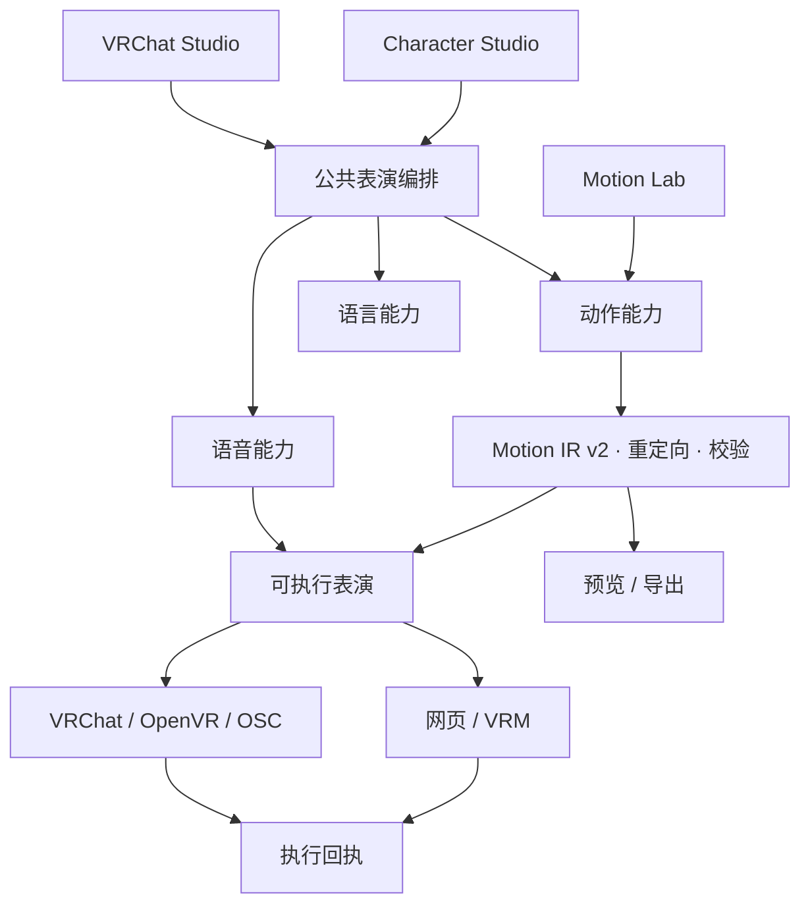

# VIREA

[English](README.md) · [简体中文](README.zh-CN.md) · [文档](doc/README.zh-CN.md) · [开始部署](doc/getting-started/automatic-setup.zh-CN.md) · [演示](#demos)

**VIREA 把语言、语音和动作模型连接到可交互的角色。** 你可以单独生成动作，在网页中与角色对话，也可以让独立 AI 角色进入 VRChat。三种工作方式共用模型接入、骨骼转换和执行记录。

## 选择你的工作台

| 工作台 | 用它做什么 | 从这里开始 |
|---|---|---|
| **Motion Lab** | 输入动作描述，比较原始骨架与角色结果，导出动画 | [动作生成指南](doc/workflows/motion-lab.zh-CN.md) |
| **Character Studio** | 导入 VRM，与角色持续对话，编排独立的语音和动作轨道 | [角色交互指南](doc/workflows/character-studio.zh-CN.md) |
| **VRChat Studio** | 控制独立 AI 账号，用观察者账号查看动作和字幕 | [VRChat 指南](doc/workflows/vrchat-studio.zh-CN.md) |

## 从零开始

1. [下载项目 ZIP](https://github.com/Moonweave-AI/virea/archive/refs/heads/main.zip) 并解压。Windows 双击 **Start-VIREA.cmd**；macOS 双击 **Start-VIREA.command**；Linux 在项目目录运行 **sh start-virea.sh**。
2. 等待启动器准备 Python、Node 和依赖。完成后会打开配置向导，界面显示部署进度与当前步骤。
3. 选择远端服务或已检测到的本地模型。远端服务填写密钥后，模型和声线通过下拉列表选择；本地模型点击 **检测并部署**。
4. 点击 **生成检验**。看到实际文本、音频波形或动作帧及可下载结果后，再启用配置。
5. 打开对应工作台。Motion Lab 只需要动作模型；两个交互工作台按需接入语言和语音模型。

| 运行环境 | 工作方式 |
|---|---|
| Windows | 三个工作台；VRChat 独立双账号与虚拟 VR 驱动 |
| Linux、macOS | Motion Lab、Character Studio、模型接入与部署 |
| Windows + WSL2 | Windows 负责网页和 VRChat，模型可选择 WSL2 运行环境 |

语言接口包括 OpenAI、DeepSeek、Anthropic、阿里百炼、Gemini、OpenRouter 及兼容服务；语音包括 OpenAI Speech、百炼、ElevenLabs、Azure 和本地服务。安装向导检测硬件并显示适合的运行环境。模型资源需求见[模型目录](doc/models/README.zh-CN.md)。

首次启动默认打开 `http://127.0.0.1:8000/app/setup.html`。设置、模型和生成结果保存在项目的 `.virea-runtime/` 中；后续启动会复用已有环境。语音检验只生成文件，播放由用户操作。

[逐步安装](doc/getting-started/automatic-setup.zh-CN.md) · [选择数据盘](doc/getting-started/persistent-data-root.zh-CN.md) · [排查问题](doc/operations/troubleshooting.zh-CN.md)

## 一个底座，三种工作方式

动作和语音共享时间轴，但拥有各自的长度和起点。短英文动作描述组成阶段序列；语音可在任意阶段开始，也可跨越动作边界。实际合成的采样数决定语音时长，动作模型保留各自的原生历史与推理方式。

执行结果按计划、生成、校验、发送、设备确认和画面观测记录。切换任务会取消旧任务并更新会话版本；两种执行端使用同一份经过校验的表演数据。

[架构总览](doc/architecture/overview.zh-CN.md) · [公共契约](doc/architecture/contracts.zh-CN.md) · [时序与执行](doc/architecture/execution.zh-CN.md)

## 看看实际效果

下面的视频来自已有实录：VRChat 四段连续交互，以及 MotionCraft、SynTalker 各八段网页表演。[录制条件与逐项记录](doc/quality/vrchat-recordings.md)包含原始文件摘要和检查结果。

<!-- BEGIN VRCHAT_DEMOS -->
### 四条连续 VRChat 交互实录

**1. 展厅导览 — MotionCraft · 5:17.6。** 介绍虚构展品、解释反射光、适应儿童访客，再回答并复盘。

https://github.com/user-attachments/assets/df0ff097-dec3-4400-afe8-5341554778f6

**2. 节奏教学 — SynTalker · 5:39.6。** 建立轮流互动规则、等待准备、纠正理解，再总结练习。

https://github.com/user-attachments/assets/e8725f1d-dc6b-4e38-bb59-ad93d6596656

**3. 灯塔故事 — MotionCraft → SynTalker · 5:16.5。** 选择路线、记住蓝色地图和不会游泳的限制、应对下雨，切换方法后继续并回顾故事。

https://github.com/user-attachments/assets/be775ee7-0f9e-42c3-8a15-da52c81487af

**4. 活动排练 — SynTalker → MotionCraft · 5:47.4。** 介绍图书交换、澄清免费规则、临时压缩成闭幕环节，再总结修订。

https://github.com/user-attachments/assets/34f49bd8-a4d7-4852-be7c-875032a364b5
<!-- END VRCHAT_DEMOS -->

<!-- BEGIN UNIFIED_MOTION_DEMOS -->

### MotionCraft

<table>
<tr>
<td width="50%" valign="top"><strong>角色介绍与迎宾</strong>  32s · 6 段动作 · 2 段语音 · motioncraft + Audio8-TTS</td>
<td width="50%" valign="top"><strong>热身教练</strong>  36s · 6 段动作 · 2 段语音 · motioncraft + Audio8-TTS</td>
</tr>
<tr>
<td width="50%" valign="top"><strong>花园故事表演</strong>  35s · 6 段动作 · 2 段语音 · motioncraft + Audio8-TTS</td>
<td width="50%" valign="top"><strong>舞步与节奏教学</strong>  32s · 6 段动作 · 2 段语音 · motioncraft + Audio8-TTS</td>
</tr>
<tr>
<td width="50%" valign="top"><strong>服装展示与转身</strong>  34s · 7 段动作 · 2 段语音 · motioncraft + Audio8-TTS</td>
<td width="50%" valign="top"><strong>从紧张到庆祝</strong>  33s · 6 段动作 · 2 段语音 · motioncraft + Audio8-TTS</td>
</tr>
<tr>
<td width="50%" valign="top"><strong>边走边讲的导览</strong>  38s · 6 段动作 · 2 段语音 · motioncraft + Audio8-TTS</td>
<td width="50%" valign="top"><strong>拳击基础组合练习</strong>  36s · 7 段动作 · 2 段语音 · motioncraft + Audio8-TTS</td>
</tr>
</table>

### SynTalker

<table>
<tr>
<td width="50%" valign="top"><strong>角色介绍与迎宾</strong>  32s · 6 段动作 · 2 段语音 · syntalker + Audio8-TTS</td>
<td width="50%" valign="top"><strong>热身教练</strong>  36s · 6 段动作 · 2 段语音 · syntalker + Audio8-TTS</td>
</tr>
<tr>
<td width="50%" valign="top"><strong>花园故事表演</strong>  35s · 6 段动作 · 2 段语音 · syntalker + Audio8-TTS</td>
<td width="50%" valign="top"><strong>舞步与节奏教学</strong>  32s · 6 段动作 · 2 段语音 · syntalker + Audio8-TTS</td>
</tr>
<tr>
<td width="50%" valign="top"><strong>服装展示与转身</strong>  34s · 7 段动作 · 2 段语音 · syntalker + Audio8-TTS</td>
<td width="50%" valign="top"><strong>从紧张到庆祝</strong>  33s · 6 段动作 · 2 段语音 · syntalker + Audio8-TTS</td>
</tr>
<tr>
<td width="50%" valign="top"><strong>边走边讲的导览</strong>  38s · 6 段动作 · 2 段语音 · syntalker + Audio8-TTS</td>
<td width="50%" valign="top"><strong>拳击基础组合练习</strong>  36s · 7 段动作 · 2 段语音 · syntalker + Audio8-TTS</td>
</tr>
</table>
<!-- END UNIFIED_MOTION_DEMOS -->

[MotionCraft / SynTalker — 技术梗概 / Technical notes](doc/character/unified-motion.zh-CN.md) · [Gallery](doc/assets/unified-motion-demos/index.html)

SentiAvatar + ARDY

<!-- BEGIN CHARACTER_DEMOS -->
**8 段完整表演，按两列四行排列。** 每段录制执行模型生成的计划，任务说明提供时长和实测数据。

<table>
<tr>
<td width="50%" valign="top"><strong>01 · 主持入场</strong> 开场介绍 → 走位、转身与致意 → 邀请观众开始。 <video src="https://github.com/user-attachments/assets/7c4006eb-5662-4c46-8697-df720d7d2e9b" controls width="100%"></video> 完整表演 · 39.2s SentiAvatar ↔ ARDY · Kokoro</td>
<td width="50%" valign="top"><strong>02 · 热身教练</strong> 讲解要领 → 侧步与伸展示范 → 总结和鼓励。 <video src="https://github.com/user-attachments/assets/6707f2ec-8708-435c-92f1-bc16db2e3573" controls width="100%"></video> 完整表演 · 42.3s SentiAvatar ↔ ARDY · Kokoro</td>
</tr>
<tr>
<td width="50%" valign="top"><strong>03 · 故事表演</strong> 讲述雨后花园 → 无声寻找与发现 → 温暖结局。 <video src="https://github.com/user-attachments/assets/0d4e9132-0ebe-41f9-b0af-a43612a20026" controls width="100%"></video> 完整表演 · 54.6s SentiAvatar ↔ ARDY · Kokoro</td>
<td width="50%" valign="top"><strong>04 · 舞步教学</strong> 节奏与重心讲解 → 即兴舞步组合 → 常见错误点评。 <video src="https://github.com/user-attachments/assets/1260333b-e3bc-4c8a-b017-a853a5236c78" controls width="100%"></video> 完整表演 · 49.9s SentiAvatar ↔ ARDY · Kokoro</td>
</tr>
<tr>
<td width="50%" valign="top"><strong>05 · 服装展示</strong> 介绍搭配与材质 → 台步、转身与换姿势 → 表达心情。 <video src="https://github.com/user-attachments/assets/5813e082-8c10-4b98-b369-ed1d321ed98c" controls width="100%"></video> 完整表演 · 51.6s SentiAvatar ↔ ARDY · Kokoro</td>
<td width="50%" valign="top"><strong>06 · 情绪转折</strong> 回应不安 → 身体动作表达庆祝 → 温暖地收尾。 <video src="https://github.com/user-attachments/assets/9fedd92d-179b-4388-a4fc-a05de5c7a5ae" controls width="100%"></video> 完整表演 · 32.2s SentiAvatar ↔ ARDY · Kokoro</td>
</tr>
<tr>
<td width="50%" valign="top"><strong>07 · 行走导览</strong> 介绍入口作品 → 边走边讲、转身示意 → 总结主题。 <video src="https://github.com/user-attachments/assets/9fd17b2d-9e5b-473c-9a02-772050581b72" controls width="100%"></video> 完整表演 · 55.3s SentiAvatar ↔ ARDY · Kokoro</td>
<td width="50%" valign="top"><strong>08 · 拳击练习</strong> 讲解站姿与守势 → 直拳、闪避与恢复 → 呼吸和节奏总结。 <video src="https://github.com/user-attachments/assets/e15d77f0-649d-4b88-adfc-4d40d6f8ef88" controls width="100%"></video> 完整表演 · 48.1s SentiAvatar ↔ ARDY · Kokoro</td>
</tr>
</table>

[任务说明与实测](doc/character/showcase.zh-CN.md) · [双列视频画廊](doc/assets/character-demos/index.html)（本地 HTTP 打开） · [执行清单](doc/assets/character-demos/manifest.json)
<!-- END CHARACTER_DEMOS -->

## 开发与深入阅读

| 我想了解 | 文档 |
|---|---|
| 调用 API、添加模型 | [统一交互 API](doc/architecture/contracts.zh-CN.md)、[模型接入](doc/development/model-adapter.zh-CN.md) |
| 骨骼坐标与重定向 | [数学文档](doc/math-retarget/README.zh-CN.md) |
| 本地环境、模型与数据 | [自动部署](doc/getting-started/automatic-setup.zh-CN.md)、[数据保留](doc/operations/runtime-data-and-retention.zh-CN.md) |
| 阅读当前实现与迁移 | [架构](doc/architecture/overview.zh-CN.md)、[RFC-0004](doc/rfcs/0004-unified-embodied-runtime.md) |
| 查看模型和平台配置 | [模型矩阵](doc/models/support-matrix.generated.md)、[平台指南](doc/platforms/README.zh-CN.md) |
| 参与贡献与验证 | [贡献指南](CONTRIBUTING.md)、[验证记录](doc/quality/unified-runtime.md) |

代码按职责组织：`apps/` 提供界面和 API，`src/virea/application/` 负责公共编排，`src/virea/ports/` 定义能力接口，`packages/` 管理契约和基础设施，`plugins/` 管理模型运行时，`doc/` 提供任务指南与技术参考。

演示角色：**Unnamed Character 6 — Reira**。仓库提供渲染结果，角色模型由使用者自行导入。项目代码许可由维护者决定；模型、数据及角色许可见 [THIRD_PARTY_NOTICES.md](THIRD_PARTY_NOTICES.md)。安全问题请参阅 [SECURITY.md](SECURITY.md)。

<!--
type: readme
status: Active
owner: VIREA maintainers
created: 2026-08-08
updated: 2026-10-11
last_reviewed: 2026-10-11
review_cycle_days: 30
summary: Three workflows over shared capabilities, motion conversion and verifiable execution.
canonical: README.zh-CN.md
related: []
supersedes: []
superseded_by: []
-->
