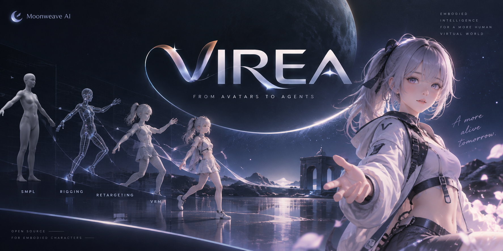
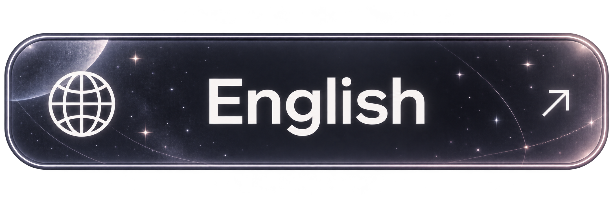
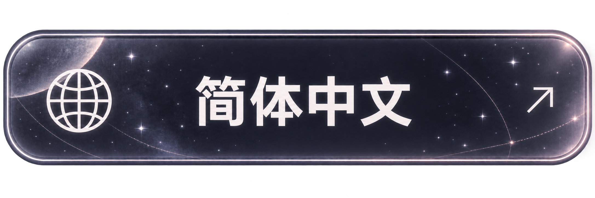
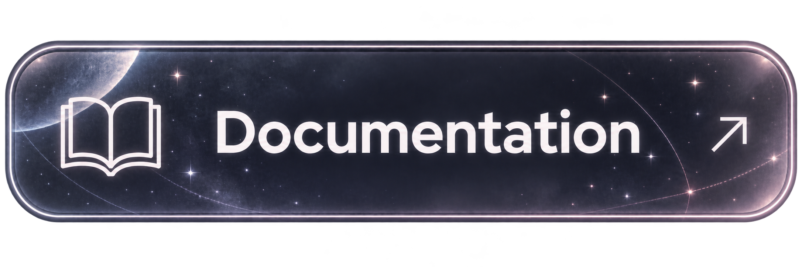
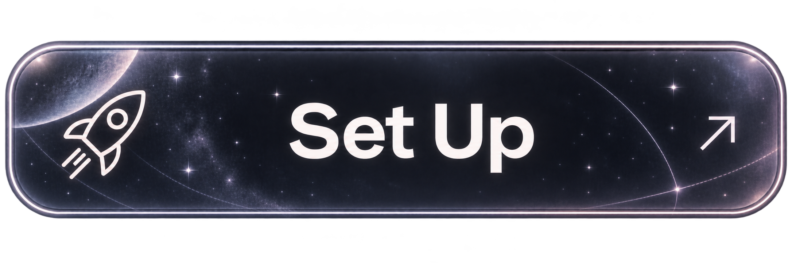
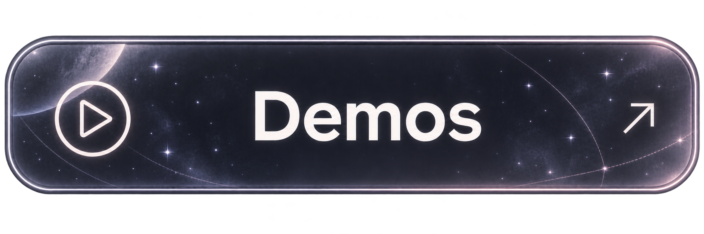
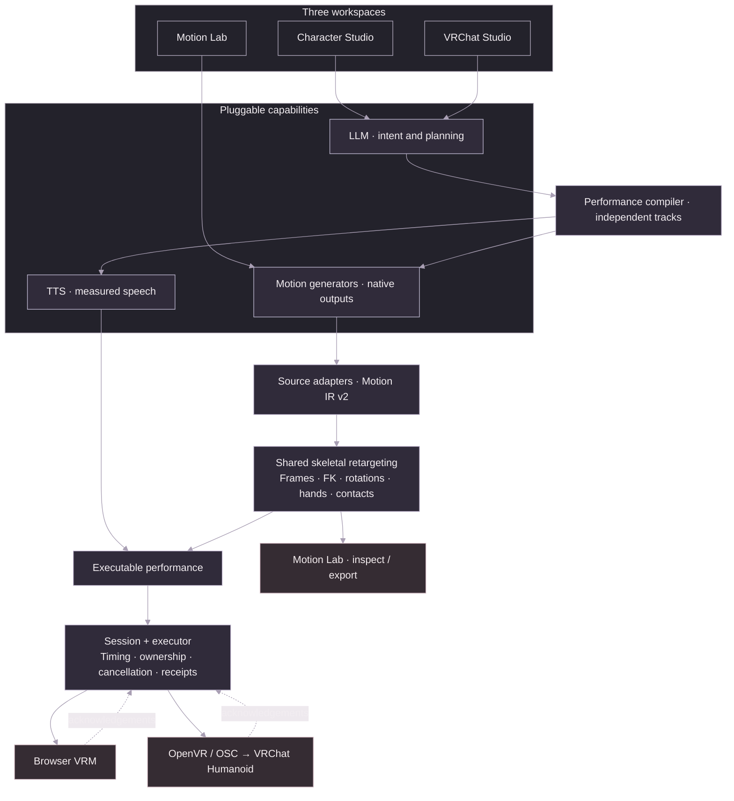

<p align="center">
  
</p>
<h1 align="center">VIREA</h1>
<p align="center"><sub>Verifiable Interaction Runtime for Embodied Agents · /ˈvɪəriə/</sub></p>

<p align="center">
  <a href="README.md"></a>
  <a href="README.zh-CN.md"></a><br>
  <a href="doc/README.zh-CN.md"></a>
  <a href="doc/getting-started/automatic-setup.zh-CN.md"></a>
  <a href="doc/demos/README.zh-CN.md"></a>
</p>

<a id="从动作生成走向持续的具身对话"></a>
<a id="model-support"></a>
<a id="documentation"></a>
## ✦ 让你的角色活过来

**VIREA 把语言、语音和动作模型连接到可观看、可交互的角色。** 它将模型的原始骨骼输出重定向到网页中的 VRM 角色，以及 VRChat 中的 Humanoid 角色，串起从模型部署、动作生成到播放与检查的完整工作流。

https://github.com/user-attachments/assets/1f2c4711-2246-466b-ae1b-84e5c5a2f746

[观看 4K 原版](https://github.com/Moonweave-AI/virea/releases/download/launch-film-2026-10/VIREA-English-4K-v2.mp4) · [下载成片与可编辑工程](https://github.com/Moonweave-AI/virea/releases/tag/launch-film-2026-10)

<table>
<tr>
<td width="33%" valign="top"><h3>01 · 🦴 让动作适配角色</h3><p>源骨架的静止坐标系、关节层级和旋转约定进入同一套重定向基础。在原始骨架与目标角色之间对照检查手指、根部移动和脚底接触。</p><a href="doc/math-retarget/README.zh-CN.md">了解骨骼与数学 →</a></td>
<td width="33%" valign="top"><h3>02 · 🔌 自由组合模型</h3><p>MotionCraft、SynTalker、ARDY 及模型目录中的其他模型，通过适配器接入各自的原始骨骼输出。云端或本地 LLM、TTS 使用统一能力接口，每个连接都能通过实际生成来检验。</p><a href="doc/models/README.zh-CN.md">浏览模型目录 →</a></td>
<td width="33%" valign="top"><h3>03 · 🎬 串起完整表演</h3><p>动作与语音分别编排：动作可以分段，语音可以从中间开始，也可以提前结束。统一消息、动作文件和执行回执把整段表演送到网页或 VRChat，让每一步都有据可查。</p><a href="doc/architecture/contracts.zh-CN.md">查看协议与接口 →</a></td>
</tr>
</table>

---

## 🧭 项目对比

这些项目分别从 AI 陪伴、动画创作或视频动捕出发。VIREA 将生成、重定向与角色执行放进同一个运行时。

| 项目 | 对话与语音 | 生成动作 | 原始骨架 → VRM | 网页角色 | VRChat 执行 | 独立时间轨 | 动作与执行契约 |
|:--|:--:|:--:|:--:|:--:|:--:|:--:|:--:|
| [Project Gabriel](https://github.com/HoppouAI/ProjectGabriel-Remastered/tree/motion-server) | ✅ | ✅ | ❌ | ❌ | ✅ | ❌ | ❌ |
| [rexclaw](https://github.com/Codemarchant/rexclaw) | ✅ | ✅¹ | ❌ | ✅ | ❌ | ❌ | ❌ |
| [text-to-vrma](https://github.com/Kirakun0328/text-to-vrma) | ❌ | ✅ | ✅ | ✅ | ❌ | ❌ | ❌ |
| [MotionMind](https://github.com/rohitacharyams/MotionMind) | ✅ | ❌² | ✅ | ✅ | ❌ | ❌ | ❌ |
| [ChatVRM](https://github.com/pixiv/ChatVRM) | ✅ | ❌ | ❌ | ✅ | ❌ | ❌ | ❌ |
| **VIREA** | ✅ | ✅ | ✅ | ✅ | ✅ | ✅ | ✅ |

<sub>✅ 在本次比较范围内已实现 · ❌ 该范围内未提供。¹ 通过 Text-To-VRMA 接入。² MotionMind 从视频恢复动作，并支持片段编排。“独立时间轨”指可显式安排语音和动作的起止时间；“动作与执行契约”同时包含统一动作表示和目标执行回执。核对日期：2026-10-11。[定义、版本与来源](doc/comparison.zh-CN.md)。</sub>

---

<a id="从零开始无需先安装开发工具"></a>
<a id="从这里开始"></a>
<a id="先决条件"></a>
<a id="最短可复现路径"></a>
<a id="高级手动选择执行域并安装模型"></a>
<a id="高级手动运行生成与播放"></a>
<a id="quick-start"></a>
## 🚀 部署与启动

**准备一个文件夹，运行启动器即可开始。** [下载源码 ZIP](https://github.com/Moonweave-AI/virea/archive/refs/heads/main.zip) 并解压，或通过 Git 下载：

```sh
git clone https://github.com/Moonweave-AI/virea.git
cd virea
```

在项目文件夹中，按操作系统运行：

| Windows · PowerShell | macOS / Linux · 终端 |
|:--|:--|
| `.\Start-VIREA.cmd` | `sh start-virea.sh` |

启动器会准备 Python、Node.js 和应用依赖，构建网页并启动服务。以后仍用同一个命令启动。

1. 启动完成后，打开 **[配置向导](http://127.0.0.1:8000/app/setup.html)**。
2. 选择**语言、语音和动作**服务。自动检测模型与声线，或从目录部署本地模型。
3. 点击**生成检验**，看到实际结果后进入 **Motion Lab**、**Character Studio** 或 **VRChat Studio**。

> [!TIP]
> 网页工作区支持 Windows、Linux 和 macOS；VRChat 接入使用 Windows。本地模型的硬件要求会在安装前显示，可以先配置自己需要的能力。

[完整部署指南](doc/getting-started/automatic-setup.zh-CN.md) · [平台说明](doc/platforms/README.zh-CN.md) · [故障排查](doc/operations/troubleshooting.zh-CN.md)

| 页面 | 默认地址 |
|---|---|
| Set Up · 配置与部署 | [打开](http://127.0.0.1:8000/app/setup.html) |
| Motion Lab · 动作生成 | [打开](http://127.0.0.1:8000/app/) |
| Character Studio · 角色对话 | [打开](http://127.0.0.1:8000/app/character.html) |
| VRChat Studio · 游戏接入 | [打开](http://127.0.0.1:8000/app/vrchat.html) |

更改端口后，以启动器打印的链接为准。更新代码后，关闭启动器并再次运行；配置、模型和结果继续保存在原数据目录。


---

<a id="demos"></a>
<a id="vrchat-执行桥接"></a>
<a id="单模型路线16-个复杂任务-demo"></a>
<a id="motion-studio-演示"></a>
## 🎞️ 演示

### Motion Lab

PRISM 与 SentiAvatar · 并排观察原始骨架与重定向角色。

https://github.com/user-attachments/assets/e7da8d2c-c453-41b2-b27b-66920dd792e8

### Character Studio

MotionCraft 驱动已有 VRM 角色，在浏览器中呈现动作与英文回复。

https://github.com/user-attachments/assets/c2a02ab9-6f57-4217-a77a-42b7130ec841

### VRChat Studio

通过 VRChat 游戏内镜面，观看模型生成的全身动作与字幕回复。

https://github.com/user-attachments/assets/9b721347-c840-4e40-a35a-2df3beb365ca

[全部演示与复现说明](doc/demos/README.zh-CN.md) · [素材来源](doc/assets/featured-demos/README.md)

<sub>演示角色：Unnamed Character 6 — Reira。[素材署名](THIRD_PARTY_NOTICES.md)。</sub>

---

<a id="architecture"></a>
<a id="现在的系统如何工作"></a>
<a id="能力实测和发布不是同一件事"></a>
## 🧩 技术架构

**一套能力接口，一套动作基础，多个执行目标。** 三个工作区共享模型接口与骨骼数学，各执行端负责自己的渲染或设备传输。



| 层次 | 负责什么 | 代码 |
|:--|:--|:--|
| 能力接口 | 可替换的语言、音频、动作、源格式与角色执行接口 | [`src/virea/ports/`](src/virea/ports/) |
| 契约与编排 | 计划、实际时长、动作文件、身体控制权与执行回执 | [`packages/contracts/`](packages/contracts/) · [`src/virea/application/`](src/virea/application/) |
| 动作基础 | 原始输出适配、静止坐标系、正向运动学与骨骼重定向 | [`src/virea/motion/`](src/virea/motion/) · [`packages/retarget/`](packages/retarget/) |
| 执行与部署 | 网页播放、VRChat 追踪、模型进程与环境部署 | [`apps/`](apps/) · [`src/virea/vrchat/`](src/virea/vrchat/) · [`plugins/models/`](plugins/models/) |

[架构说明](doc/architecture/overview.zh-CN.md) · [时间轴与执行](doc/architecture/execution.zh-CN.md) · [接入新模型](doc/development/model-adapter.zh-CN.md)

---

<a id="维护与贡献"></a>
<a id="contributing-security-and-distribution"></a>
## 🤝 Contributing · 参与贡献

欢迎带来模型适配器、清晰的教程、可复现的动作样本或问题修复。从[贡献指南](CONTRIBUTING.md)开始，选择一个明确的改动，并附上能说明效果的检查结果。涉及动作时，原始骨架与目标角色的同帧对照尤其有帮助。

---

## 🛡️ Security & responsible use · 安全与负责任使用

使用已获许可的角色和声音素材，将服务密钥、私人对话留在本地，并尊重 VRChat 中其他参与者的意愿。漏洞私密报告见[安全政策](SECURITY.md)，模型、数据集和角色的使用条款见[第三方说明](THIRD_PARTY_NOTICES.md)。

---

## 📄 License · 许可

VIREA 项目代码的许可证由维护者确定，目前尚未选定。第三方模型、数据集和角色保留各自的许可，详见[第三方说明](THIRD_PARTY_NOTICES.md)。

<!--
type: readme
status: Active
owner: VIREA maintainers
created: 2026-10-11
updated: 2026-10-13
last_reviewed: 2026-10-13
review_cycle_days: 30
summary: Project overview, verified comparison, quick setup, the launch film and three current demos and shared architecture.
canonical: README.zh-CN.md
related: []
supersedes: []
superseded_by: []
-->
