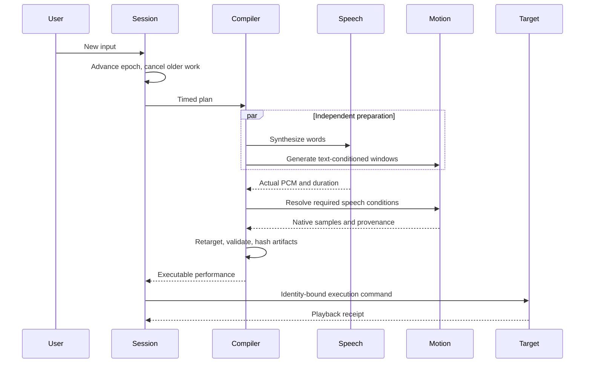

# Timing, cancellation and execution evidence

[中文](execution.zh-CN.md) · [Overview](overview.en.md)

Speech and body movement are separate tracks. Place speech at an absolute offset or after a previous clip. The scheduler measures PCM samples, resolves dependencies and publishes final intervals before playback. Generated plans shift overlapping speech forward; explicitly authored plans preserve strict timing and report conflicts.

MotionCraft text-only windows can run while speech is being synthesized. Speech-conditioned MotionCraft windows and SynTalker windows wait for the relevant audio. Native history, latent window geometry and sequence finalization remain model-specific. Prepared playback begins once the full performance is available.

The session epoch increases on interruption or replacement. Old acknowledgements and late publications are rejected. Only one command owns the body channel. Interruption preserves the last acknowledged body state; it does not invent a new rest pose.

Execution commands include the expected state revision, expiration, authorized capabilities and a payload digest. Identical replay does not start another execution. Reusing an idempotency key with another command is rejected. Artifact integrity is checked again when the target loads it.

| Evidence | What it establishes |
|---|---|
| planned | A validated intent exists |
| generated | The model produced a result |
| validated | The result passed its contract and quality checks |
| sent | Output was transmitted |
| device_ack | The playback target acknowledged it |
| observed_rendered | A referenced observation records the rendered result |
| semantically_satisfied | Referenced evidence supports the requested outcome |

Character Studio and VRChat Studio display the current turn and receipt. The immutable native, audio and playback artifacts live in `characters/artifacts/` under the configured VIREA data root. The session's temporary HTTP playback files are released after acknowledgement. Content-addressed audit artifacts remain for inspection; apply the project's [data retention policy](../operations/runtime-data-and-retention.en.md) when clearing a workspace.
