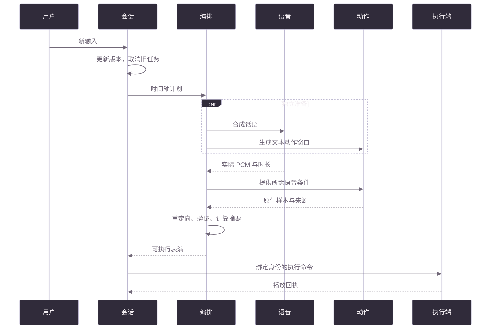

<!-- BEGIN DOC NAV -->
[✦ VIREA](../../README.zh-CN.md) · [文档](../README.zh-CN.md) · [部署](../getting-started/automatic-setup.zh-CN.md) · [演示](../demos/README.zh-CN.md) · [English](execution.en.md)
<!-- END DOC NAV -->

# 时序、取消与执行证据

[English](execution.en.md) · [架构总览](overview.zh-CN.md)

语音与身体动作是两条独立轨道。语音可指定绝对起点，也可跟随前一片段。调度器测量 PCM 采样数，解析依赖，在播放前确定最终区间。自动生成计划中的语音重叠会顺延处理；显式编写的计划保留严格时间约束并报告冲突。

MotionCraft 的纯文本动作窗口可与语音合成并行。需要语音条件的 MotionCraft 窗口和 SynTalker 窗口等待对应音频。原生历史、潜变量窗口大小和最终解码遵循各模型的协议。准备式播放在整段表演可用后开始。

中断或替换任务会提升会话版本。旧回执和迟到结果无法覆盖新任务；一个命令拥有身体控制权。中断保留最近确认的身体状态。

命令包含预期版本、有效期、授权能力和制品摘要。会话保留最近 128 个已接收命令及其结束回执：重试会等待正在执行的任务，或返回已有回执；后续命令完成后，仍可查回较早命令的结果。命令 ID 与幂等键保持对应。`accepted` 确认之后继续等待实际播放结果。执行端加载时再次检查制品完整性。

结束回执会在同一次同步更新中释放身体控制权，并移除待播放包。异步任务随后整理历史、清理临时文件；播放端无需等待清理计时，也不会重新读取已经结束的动作。

| 证据级别 | 表示什么 |
|---|---|
| planned | 已建立有效意图 |
| generated | 模型已产出结果 |
| validated | 结果已通过契约与质量检查 |
| sent | 输出已发送 |
| device_ack | 播放端已确认 |
| observed_rendered | 有引用的画面观测 |
| semantically_satisfied | 有证据支持任务效果符合要求 |

Character Studio 与 VRChat Studio 显示当前轮次和回执。原生动作、音频和播放制品按内容摘要保存在数据根目录的 `characters/artifacts/`。会话临时 HTTP 文件在确认后释放，审计制品继续保留，清理时遵循[数据保留指南](../operations/runtime-data-and-retention.zh-CN.md)。

<!-- BEGIN DOC FOOTER -->
---

[📚 文档地图](../catalog.zh-CN.md) · [🛠️ 故障排查](../operations/troubleshooting.zh-CN.md) · [🤝 参与贡献](../../CONTRIBUTING.md)
<!-- END DOC FOOTER -->

<!--
type: explanation
status: Active
owner: VIREA maintainers
created: 2026-10-11
updated: 2026-10-11
last_reviewed: 2026-10-11
review_cycle_days: 30
summary: Unified runtime execution.
canonical: doc/architecture/execution.zh-CN.md
related: []
supersedes: []
superseded_by: []
-->
