# Architecture: one foundation, three workspaces

[中文](overview.zh-CN.md) · [Documentation](../README.en.md) · [Design decision](../rfcs/0004-unified-embodied-runtime.md)

VIREA is a Verifiable Interaction Runtime for Embodied Agents. Motion Lab, Character Studio and VRChat Studio are workflows over shared capabilities. A browser VRM and an independent VRChat character are execution targets.

```mermaid
flowchart LR
    Input[Input] --> Router[Request router]
    Router --> Lab[Direct motion job]
    Router --> Planner[Language planning]
    Planner --> Compiler[Performance compiler]
    Compiler --> Audio[Speech preparation]
    Compiler --> Native[Native motion worker]
    Lab --> Native
    Native --> IR[Motion IR v2]
    IR --> Retarget[Public retarget boundary]
    Retarget --> Validation[Quality validation]
    Validation --> Artifact[Immutable performance]
    Audio --> Artifact
    Artifact --> Gate[Epoch and execution gate]
    Gate --> Web[Browser / VRM]
    Gate --> VRC[VRChat / OpenVR / OSC]
    Web --> Receipt[Execution receipt]
    VRC --> Receipt
```

## Responsibility map

| Location | Responsibility |
|---|---|
| `packages/contracts/src/virea_contracts/performance.py` | Intent, artifacts, executable performances, commands and receipts |
| `packages/contracts/src/virea_contracts/timeline.py` | Independent speech and motion track validation |
| `src/virea/ports/` | Language, audio, motion, source conversion and embodiment interfaces |
| `src/virea/adapters/` | Typed language plans, measured audio artifacts and native motion adapters |
| `src/virea/application/` | Request routing, preparation, sample timing, immutable artifacts, epochs and delivery |
| `src/virea/motion/` | Existing skeleton, quaternion, hand and kinematic mathematics |
| `packages/retarget/` | Public `retarget_motion_ir` entry point, actors and auxiliary tracks |
| `src/virea/character/` | Character context, provider adapters, browser delivery and legacy orchestration |
| `src/virea/vrchat/` | AI identity, calibration, native pose transport, input, room and capture adapters |
| `apps/api/`, `apps/web/` | HTTP routes, model management and the three workspaces |
| `plugins/models/`, `registries/` | Isolated workers, assets, runtime profiles and model facts |

## Motion foundation

Motion Lab already normalizes native outputs to Motion IR v2 and calls the public retarget package. The interactive MotionCraft and SynTalker paths now use that same retarget boundary. The numerical implementation remains in `src/virea/motion`; the previous character import paths are compatibility facades.

MotionCraft supplies observed local rotations, which are preserved through conversion. SynTalker supplies joint positions; its existing palm, twist observability and hand constraints remain in effect. Source profiles describe the model's representation. Target rig profiles describe the avatar. Changing an avatar does not change the source profile.

Motion IR retains multiple actors and face, gaze, contact and object tracks. The prepared humanoid playback adapter currently consumes one body's windows and speech; its native artifact is retained alongside the playback payload. New track consumers can use the existing IR rather than adding another motion tensor format.

## Preparation and execution

`PerformanceCompiler` owns speech task cleanup, actual-duration scheduling, native generation and bounded quality retries. `SessionCoordinator` owns the active turn, epoch and body owner. `PerformanceExecutor` validates target identity, revision, expiry, capabilities and payload hashes. `load_delivery` rechecks artifacts immediately before a target loads them.

Browser and VRChat playback keep their target-specific clocks and device code. Each performance uses one target playback clock for motion, speech and subtitles. The server's pause-aware acknowledgement deadline measures waiting time, not a second animation timeline.

SentiAvatar + ARDY retains its semantic body-program planner and streaming behavior path. `IntentPlan` names that semantic plan; `TimedPerformancePlan` names the independent timed tracks. Existing `PerformancePlan` imports remain compatible. Shared state and timing utilities are extracted incrementally without rewriting those algorithms.

The model control plane continues to own installation, resource admission, worker processes and result export. These are runtime infrastructure, separate from conversational session orchestration.

See [contracts](contracts.en.md), [execution](execution.en.md), and [migration evidence](../quality/unified-runtime.md).
