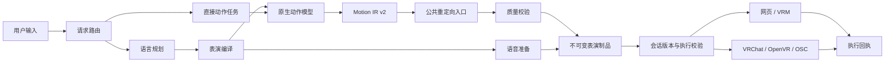

# 架构：一个底座，三种工作台

[English](overview.en.md) · [文档首页](../README.zh-CN.md) · [设计决策](../rfcs/0004-unified-embodied-runtime.md)

VIREA 是面向具身智能体的可验证交互运行时。Motion Lab、Character Studio、VRChat Studio 共享能力与编排；网页 VRM 和 VRChat 独立角色负责执行。

## 职责分工

| 位置 | 职责 |
|---|---|
| `packages/contracts/src/virea_contracts/performance.py` | 意图、制品、可执行表演、命令和回执 |
| `packages/contracts/src/virea_contracts/timeline.py` | 独立语音与动作轨道的验证 |
| `src/virea/ports/` | 语言、语音、动作、源数据转换和具身执行接口 |
| `src/virea/adapters/` | 类型化语言计划、实测音频产物及原生动作适配器 |
| `src/virea/application/` | 路由、生成准备、采样排程、制品、会话版本和交付 |
| `src/virea/motion/` | 现有骨骼、四元数、手部和运动学数学 |
| `packages/retarget/` | 公共 `retarget_motion_ir` 入口、多角色与附加轨道 |
| `src/virea/character/` | 角色上下文、模型适配、网页交付和已有行为编排 |
| `src/virea/vrchat/` | AI 身份、校准、原生姿态传输、输入、房间与采集 |
| `apps/api/`、`apps/web/` | HTTP 路由、模型管理与三个工作台 |
| `plugins/models/`、`registries/` | 隔离运行时、模型资产和运行配置 |

## 动作底座

Motion Lab 已经通过 Motion IR v2 调用公共重定向包。交互场景中的 MotionCraft 和 SynTalker 现在也经过同一个入口。数学实现继续放在 `src/virea/motion`；原有角色模块路径作为兼容入口保留。

MotionCraft 提供局部旋转，通过显式源骨架几何转换到目标局部轴，保留已观测的扭转。原始制品、未滤波的标准化旋转和播放曲线分别保留。SynTalker 使用恢复出的关节位置及对应的扭转可观测性与手部约束。源表示描述模型输出，目标骨架描述角色；离线转换和实时设备目标使用同一套刚体 FK。推导与对照见[骨骼数学研究记录](../research/skeletal-retargeting-2026-10-11.md)。

Motion IR 保留多角色、面部、视线、接触和物体轨道。当前准备式人形播放适配器消费单个身体的动作窗口和语音，原生制品随播放制品一起保留。后续轨道消费者可继续使用同一份 IR。

## 准备与执行

`PerformanceCompiler` 管理语音任务、真实时长排程，以及每次请求的一次原生动作生成。`SessionCoordinator` 管理当前轮次、版本和身体控制权。`PerformanceExecutor` 校验目标、版本、有效期、能力与制品摘要。`load_delivery` 在播放端加载前再次检查文件。

网页和 VRChat 分别保留自己的播放时钟与设备代码。每次表演由一个目标播放时钟驱动动作、语音和字幕；服务端可暂停的确认等待期限只负责超时。

SentiAvatar + ARDY 保留已有语义行为规划和流式行为流程。`IntentPlan` 表示语义计划，`TimedPerformancePlan` 表示独立时间轨道；旧 `PerformancePlan` 导入仍兼容。公共状态与时序工具逐步抽出，模型算法保持原样。

模型控制面继续管理安装、资源准入、工作进程和导出，这些职责属于运行时基础设施。

继续阅读[契约](contracts.zh-CN.md)、[时序执行](execution.zh-CN.md)和[迁移验证](../quality/unified-runtime.md)。
