<!-- BEGIN DOC NAV -->
[✦ VIREA](../../README.md) · [Documentation](../README.en.md) · [Set Up](automatic-setup.en.md) · [Demos](../demos/README.en.md) · [简体中文](automatic-setup.zh-CN.md)
<!-- END DOC NAV -->

# Set up VIREA from zero

[中文](automatic-setup.zh-CN.md) · [Documentation](../README.en.md)

Download the repository ZIP and extract it to a folder you want to keep. The base environment needs about 5 GiB; local models need additional storage. Windows 10/11, recent Linux distributions and macOS can run the setup wizard and browser workspaces.


## From a folder to a character

```mermaid
%%{init: {"theme":"base","themeVariables":{"primaryColor":"#302b3a","primaryTextColor":"#f2edf1","primaryBorderColor":"#bdb8d1","secondaryColor":"#352c33","secondaryTextColor":"#f2edf1","secondaryBorderColor":"#c9adb8","tertiaryColor":"#23222b","tertiaryTextColor":"#f2edf1","tertiaryBorderColor":"#a49baa","lineColor":"#a89eb3","textColor":"#716878","edgeLabelBackground":"#eee9ee","clusterBkg":"#23222b","clusterBorder":"#a49baa","titleColor":"#f2edf1","noteBkgColor":"#eee9ee","noteTextColor":"#302b3a","noteBorderColor":"#a49baa"}}}%%
flowchart LR
    A["📁 Download"] --> B["🚀 Launch"] --> C["🔌 Detect providers"] --> D["✓ Generate a result"] --> E["🎭 Open a workspace"]
    classDef lunar fill:#262431,stroke:#b9b0c8,color:#f4eef2
    class A,B,C,D,E lunar
```

<!-- setup-flow -->


## 1. Open the launcher

| System | In the extracted project folder |
|---|---|
| Windows | Double-click **Start-VIREA.cmd** |
| macOS | Open **Start-VIREA.command**, or run **sh start-virea.sh** in Terminal |
| Linux | Run **sh start-virea.sh** in a terminal |

Keep the launcher open. It prepares a local Python 3.12 and Node.js 24 environment, installs the locked dependencies, builds the UI and starts the API. The terminal shows eight steps, a percentage and download progress. Later starts reuse the environment.

The browser opens `http://127.0.0.1:8000/app/setup.html`. Your files stay together:

```text
.virea-runtime/portable/
  tools/         Python, Node and package managers
  environment/   Installed application dependencies
  cache/         Reusable downloads
  home/          Configuration, model files, results and service logs
```

To choose another disk or port, use the options in [persistent data locations](persistent-data-root.en.md). The terminal prints all four workspace links using your selected port.

## 2. Connect the capabilities you need

| Capability | Selection | Verification result |
|---|---|---|
| Language | Choose a provider, enter its key, then choose a discovered model | A generated structured reply, elapsed time and a downloadable result |
| Speech | Choose a provider, model and named voice; Azure also asks for a region | A generated waveform, duration and WAV download |
| Motion | Choose MotionCraft or SynTalker for interactive performances, or a model from the Set Up motion library | Generated motion frames, dimensions, elapsed time and an NPZ download |

Use **Detect, test & activate** to detect, test and activate a connection. Use **Run generation test** to repeat the test. An edited connection stays a draft until its new generation check passes. Speech verification creates a file; press a playback control when you want to hear it.

The language presets include OpenAI, DeepSeek, Anthropic, Alibaba Bailian, Gemini, OpenRouter, Groq and SiliconFlow. Local discovery finds Ollama, LM Studio, llama.cpp and VIREA endpoints. Speech presets include OpenAI Speech, Bailian, ElevenLabs, Azure and local services. Choose the region that belongs to your provider key. Models and voices are selected from lists.

For voice cloning, use an existing provider clone or import reference audio and its matching transcript into [Audio8](../character/audio8-tts.zh-CN.md). Kokoro offers pretrained voices.

For **DeepSeek**, paste your key and click **Detect, test & activate**. VIREA lists the models available to that account and uses JSON Object for structured replies, including streamed conversations and motion planning. Older connections saved with JSON Schema are adapted automatically. Keep **Use provider defaults** selected in advanced settings.

## 3. Deploy a local model

Choose an installation recipe and click **Detect & deploy**. The page shows the current step, percentage and download progress. VIREA reuses healthy local services and cached assets; otherwise it prepares an isolated environment, downloads the pinned source and model files, starts the service and runs a generation check.

| Local model | Compute options | What is installed |
|---|---|---|
| Ollama | Automatic, CPU, supported GPU | Selected language model and service |
| Kokoro | CPU, NVIDIA CUDA, Apple MPS | Speech model, dictionaries and voices |
| Audio8 | CPU, NVIDIA CUDA | Official INT4 ONNX model and reference-voice encoder |
| MotionCraft / SynTalker | CPU or NVIDIA CUDA | Isolated runtime, source and model weights |

Choose **Automatic** for a device recommendation, or choose CPU/GPU explicitly. An unsupported accelerator produces an actionable error; it is never reported as working GPU inference after silently using CPU. Audio8’s reference-voice encoder runs on CPU; its speech model uses the selected device. See the [model catalog](../models/README.en.md) for memory requirements.

**Your device** shows OS, CPU, available RAM, disks, GPU memory, tools and discovered local services. **Environments & storage** lists host/WSL execution domains, Python candidates, Conda/Mamba environments and registered runtimes. These settings live in Set Up; Motion Lab opens directly into creation.

Each model has one deployment card. Its current run shows six steps, overall percentage, download bytes, transfer speed, elapsed time and an expandable process log. Earlier attempts are folded into history. Completed cards include the generated result and service controls. The launcher prints the same deployment events while the page is used, then lists links to all three studios.

### Follow an installation

The terminal and Set Up share live installer updates. Large CUDA/PyTorch dependencies show the package being downloaded, transferred bytes, total size, speed and estimated time remaining. Installation switches to a package-count bar, such as **4 / 10 packages**. The current stage and the overall deployment each have their own progress bar.

| Stage | What you see |
|:--|:--|
| Resolve | Dependency resolution and the latest installer message |
| Download | Package name, MiB/GiB transferred, percentage, speed and ETA when available |
| Prepare / install | Completed packages out of the reported total |
| Build / extract | Current operation and live output; an animated bar when no total is reported |
| Verify | The actual generated result and its verification receipt |

After ten seconds without new installer output, the page shows **Waiting for the installer's next update** and clears the old speed estimate. Open **Process log** to inspect the last message. Percentages come from the installer, not the elapsed timer. Re-running the launcher reuses completed downloads and prints the exact Set Up and studio URLs for your selected port.

The **Motion model library** distinguishes **Ready**, **Found locally** and **Available**. Ready models open directly in Motion Lab. Connect an existing model to reuse its pinned local files and verify its environment. Sources must match the requested revision; immutable weights are shared with hard links when possible. Keep project data in ignored `.virea-runtime/`; external shared model stores such as Ollama are detected in place.

Cancel and retry keep reusable downloads. Successful services restart with VIREA. **Stop & disable autostart** stops a VIREA-managed service and turns off its automatic recovery.

## 4. Open a workspace

- [Motion Lab](../workflows/motion-lab.en.md): describe an action, generate it, compare skeletons and export.
- [Character Studio](../workflows/character-studio.en.md): import a VRM and interact through independent speech and motion tracks.
- [VRChat Studio](../workflows/vrchat-studio.en.md): on Windows, connect separate AI and observer accounts, calibrate and inspect the AI from the observer's view.

The header provides English/Chinese and light/dark/system appearance settings. Character Studio opens settings only when requested. Conversation text keeps its original language.

The browser shows generation and execution separately. Inspect the model result first, then check movement and subtitles in the selected target.

## Recover a connection

| Message | Next step |
|---|---|
| Connection timeout | Check the endpoint or local service status, then retry detection |
| HTTP 400 or 422 | Check the specific parameter or format hint. Detect the connection again and use the provider defaults |
| HTTP 402 | Add credit in the provider console, then retry the generation check |
| HTTP 401 or 403 | Select the correct region and update the provider key |
| HTTP 429 | Check the provider quota and retry when available |
| No voices found | Select a built-in voice, or create a clone in the provider console and detect again |
| Insufficient memory | Select a smaller model, another runtime or a remote connection |

Keys are stored on the server: Windows uses user-bound DPAPI; Linux and macOS use an owner-only file or environment variables. Generation checks use the selected provider's normal inference API. Receipts, hashes and results are stored in `verification/` beside the connection configuration.

[Automation API](../reference/onboarding-api.md) · [Platform guides](../platforms/README.en.md) · [Validation evidence](../quality/portable-onboarding.md)

<!-- BEGIN DOC FOOTER -->
---

[📚 Documentation map](../catalog.en.md) · [🛠️ Troubleshooting](../operations/troubleshooting.en.md) · [🤝 Contributing](../../CONTRIBUTING.md)
<!-- END DOC FOOTER -->

<!--
type: tutorial
status: Active
owner: VIREA maintainers
created: 2026-10-11
updated: 2026-10-13
last_reviewed: 2026-10-13
review_cycle_days: 30
summary: Start from a source ZIP, configure model providers, and deploy local models through the setup wizard.
canonical: doc/getting-started/automatic-setup.en.md
related:
  - automatic-setup.zh-CN.md
  - ../reference/onboarding-api.md
supersedes: []
superseded_by: []
-->
