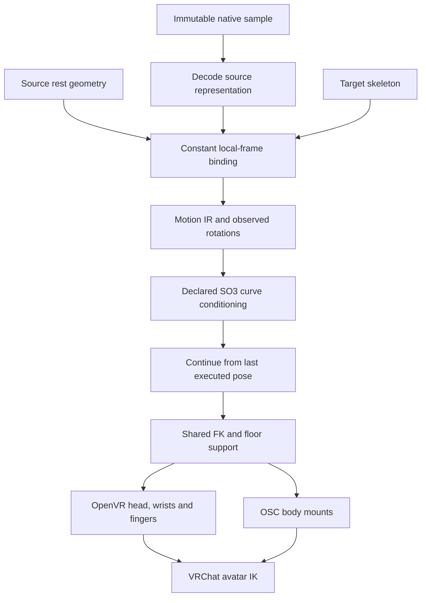

# Motion execution quality

One generated sample has three measurable stages: source geometry, prepared motion and device execution. Raw samples keep their content digest. Retargeting changes coordinate frames and bone lengths; playback conditioning has its own declared policy.

## Source and target frames

`RigGeometry` owns a topologically ordered hierarchy, parent-local offsets and rigid FK. Offline conversion and live tracking call this same implementation. Constant bindings use normalized outgoing bone directions. Chains determine swing; branches determine an orientation fit; leaves inherit the parent frame. Binding residuals record differences in branch geometry.

World quaternions compose directly along the hierarchy. This retains their continuous representative through a full turn instead of extracting a potentially opposite sign from rotation matrices at each frame. A 360-degree parent-and-child regression checks both continuity and world positions.

For a source rotation `R_j` and a target-to-source rest binding `C_j`, the target local rotation is `C_parent⁻¹ R_j C_j`. The root is `R_root C_root`. This preserves observed axial rotation and angular distances between frames. The [mathematical research record](../research/skeletal-retargeting-2026-10-11.md) gives the derivation, property tests and fixed-sample measurements.

The SMPL-X adapter accepts complete source rest offsets. Installed numeric geometry is detected in `VIREA_HOME/model-store/assets/skeletons/`: `SMPLX_NEUTRAL.npz`, `smplx-neutral.npz` or `smplx-neutral.npy`. A model NPZ supplies numeric `J_regressor` and `v_template`; an exported profile supplies `joints55` in metres. The reader disables pickle loading. Source geometry has a SHA256 digest. The legacy path without a profile identifies its geometry as `canonical_approximation` in codec metadata.

Hands use each frame's supplied axis-angle rotations. Loading a body model does not add a mean hand pose. An upstream provider that emits offsets from a reference must explicitly decode its reference before supplying absolute local rotations. Joint positions alone cannot determine axial twist or terminal finger rotation; position-based adapters retain their observability policy.

## Rotation curves

MotionCraft's official viewer smooths pose parameters at sigma 3.5 samples and root translation at sigma 3 samples. VIREA uses the same bandwidth at 30 Hz, with a Gaussian-weighted Markley mean on SO(3). Quaternion sign changes and the ±π axis-angle boundary cannot create artificial cancellation. The operation commutes with constant local-frame changes.

Windows declare `rotation_conditioning: so3_gaussian_sigma3.5.v1`. This is derived playback motion: its angles can differ from the native sample. The source artifact and normalized unfiltered rotations remain available. Generation runs once for the requested seed; retarget errors never silently replace the sample.

## Device geometry

VRChat calibrates elbow trackers on upper arms and knee trackers on thighs. Both mounts are placed 90% along the upper segment, above the hinge, and use that segment's orientation. Wrist and foot targets then move when the hinge bends without rotating a tracker attached to the proximal segment. The same equations serve calibration, playback and pose holding. [VRChat tracking](https://docs.vrchat.com/docs/full-body-tracking), [IK reference](https://docs.vrchat.com/docs/ik-20-features-and-options).

Windows declaring `grounding: prevent_penetration` receive a root-height correction `max(0, -h)`, where `h` is the lowest foot/toe height after continuity blending. All head, hand and body targets use the corrected root. Horizontal travel, rotations and positive foot clearance remain unchanged. The receipt reports the maximum lift. This represents the calibration floor plane.

## Completion and evidence

A terminal receipt removes pending delivery and releases body ownership synchronously. The producer may complete history and file cleanup afterwards. This removes the race that reloaded a completed packet and produced `execution no longer owns the body channel`.

Regression tests cover arbitrary joint-frame changes, constant bone lengths, independent single-frame and batch FK agreement, SO(3) sign/frame invariance, branch-cut continuity, native-sample identity, thigh mounts, ground support and terminal ownership. Device acknowledgements establish transmitted inputs; observer measurements establish rendered motion. Current measurements and original recordings are linked from the [validation ledger](unified-runtime.md).
