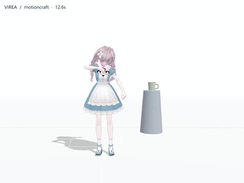

<!-- BEGIN DOC NAV -->
[✦ VIREA](../../README.zh-CN.md) · [文档](../README.zh-CN.md) · [部署](../getting-started/automatic-setup.zh-CN.md) · [演示](../demos/README.zh-CN.md) · [English](character-studio.en.md)
<!-- END DOC NAV -->

# Character Studio：与角色对话

<!-- WORKSPACE ROUTE -->
> 🎭 **准备 → 生成 → 观察 → 导出** · [先看演示](../demos/README.zh-CN.md)

[English](character-studio.en.md) · [先完成部署](../getting-started/automatic-setup.zh-CN.md)

导入 VRM，让角色在网页中结合对话与模型动作进行表演。

1. 打开 `/app/character.html`，导入角色并开始会话。
2. 选择通过检验的语言、语音和动作模型。独立轨道默认使用 MotionCraft，也可选择 SynTalker 或已有 SentiAvatar + ARDY 流程。
3. 用自然语言说明交互目标。需要明确编排时，每个动作阶段采用简洁英文描述。
4. 查看规划和生成进度。时间轴分别显示动作与语音，执行状态显示当前轮次及最近确认。
5. 随时暂停、中断或发送新请求。新轮次替代尚未完成的生成，并保留角色最近确认的姿态。
6. 在播放工具中导出动作或录制视频。

例如：先挥手四秒，再行走六秒；介绍语在挥手开始两秒后播放。语音长度以真实合成为准，可以跨越动作阶段。

[每个模型八段案例](../character/unified-motion.zh-CN.md) · [声音克隆](../character/audio8-tts.zh-CN.md) · [时序模型](../architecture/execution.zh-CN.md)

<!-- BEGIN DOC FOOTER -->
---

[📚 文档地图](../catalog.zh-CN.md) · [🛠️ 故障排查](../operations/troubleshooting.zh-CN.md) · [🤝 参与贡献](../../CONTRIBUTING.md)
<!-- END DOC FOOTER -->

<!--
type: how-to
status: Active
owner: VIREA maintainers
created: 2026-10-11
updated: 2026-10-11
last_reviewed: 2026-10-11
review_cycle_days: 30
summary: Use the character-studio workspace.
canonical: doc/workflows/character-studio.zh-CN.md
related: []
supersedes: []
superseded_by: []
-->
