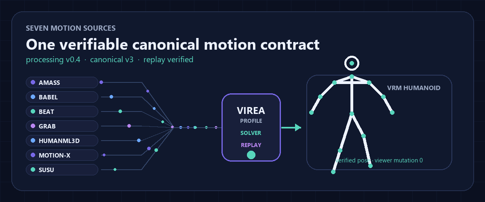

# Motion Lab

[中文](motion-lab.zh-CN.md) · [Set up first](../getting-started/automatic-setup.en.md)

Use Motion Lab to generate and inspect an animation independently of conversation or speech.

1. Open the main workspace at `/app/`.
2. Select a motion model and run its installation or generation check if needed.
3. Choose the runtime detected for your machine. Enter a short English caption, for example `A person waves with one hand.`
4. Set the duration and seed, then submit the job. Follow loading, generation, normalization, retargeting, validation and export progress.
5. Compare the native skeleton and target avatar. Inspect wrists, feet, heading and root movement while scrubbing the timeline.
6. Download the generated animation and its result metadata.

Motion Lab uses native model adapters, Motion IR v2 and the public retarget pipeline. It runs without an LLM connection, TTS voice or character session.

For model requirements, see the [catalog](../models/README.en.md). For command-line operation, see [first generation](../getting-started/first-generation.en.md). For mathematical inspection, see [retargeting](../math-retarget/README.zh-CN.md).

